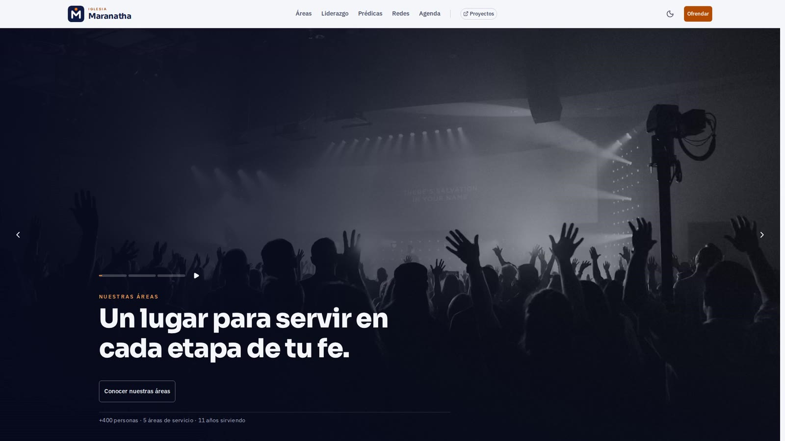
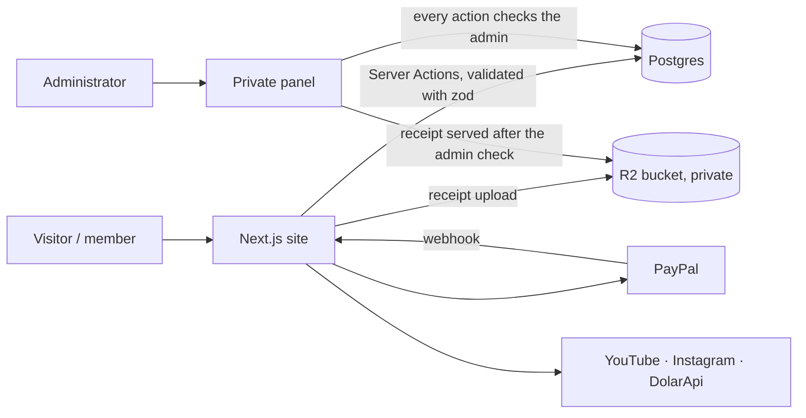

# Iglesia Maranatha

> The website of a church in Venezuela: visitors find the weekly meetings, sermons and
> projects, members give their tithe or support a project online, and the church's
> administrators approve each payment from a private panel.

*El sitio de la Iglesia Maranatha: reuniones, prédicas y proyectos para quien visita, diezmos
y aportes en línea para los miembros, y un panel privado donde la iglesia aprueba cada pago.*

[Live site](https://maranathasancristobal.com) · In production · [](https://github.com/Fockus26/maranatha/actions/workflows/ci.yml)



## What it does

- A visitor reads the home page: service areas, leaders, the weekly agenda, the latest
  sermons from YouTube and the church's Instagram feeds.
- A visitor browses the church's projects, each with its goal, what has been raised and its
  own page.
- A member gives a tithe or an offering, once or monthly, choosing the amount and how to pay:
  PayPal (account or card) or a transfer by Pago Móvil, Zelle, Bancolombia or Binance.
- A member who pays by transfer sees the amount converted to bolívares or Colombian pesos at
  the day's rate, then reports the payment with its reference and a photo or PDF of the
  receipt.
- An administrator signs in to the private panel, reviews the reported payments with their
  receipts and confirms or rejects each one. Only confirmed payments count towards a
  project's total.
- An administrator edits the agenda (weekly meetings and one-off events) and it changes on
  the public site.
- Anyone can switch between light and dark mode; the choice is remembered.

## How it is built

| Layer | Choice |
|---|---|
| Framework | Next.js 16 (App Router), React 19 with the React Compiler, strict TypeScript |
| UI | shadcn/ui (Radix) and Tailwind 4, with every colour, size and radius generated from `theme/tokens.ts`; framer-motion for transitions |
| Data | Postgres with Drizzle, reached only from server code (`lib/db/`); receipts in a private Cloudflare R2 bucket per environment |
| Auth | Better Auth, for the panel only: no public sign-up, access by an allow-list of emails, password recovery by email (React Email over SMTP) |
| Payments | PayPal orders and monthly subscriptions confirmed by webhook; manual methods reported with a receipt; Binance Pay by webhook behind an environment flag |
| External data | YouTube (sermons), Behold.so (Instagram), DolarApi (exchange rates, with a fallback rate stored in the database) |
| Hosting | Docker on a VPS: `main` goes to production and every pull request gets its own preview |



## Decisions worth noting

**One payment flow for donors that no single gateway covers.**
Donors are in Venezuela, Colombia and abroad, and no gateway reaches all of them. The site
offers PayPal, confirmed automatically by return and webhook, next to local transfers that
the donor reports with a receipt. A method whose account details are not configured is
simply not offered. The cost: every manual payment waits for a person to approve it, and the
panel exists largely to make that approval quick.

**From Supabase to a self-hosted Postgres, without resetting any account.**
The database, the sessions and the file storage moved from Supabase to a Postgres on a VPS,
with Drizzle and Better Auth inside the app. User ids were kept and the old bcrypt hashes are
still verified, so no administrator had to set a new password. The cost: the functions,
triggers and views were ported by hand, password recovery had to be built (Supabase gave it
for free), and authorisation is now a single gate in server code (`getAdminStrict()`) that
every admin action must call.

**The panel notices changes it did not make, without polling.**
A payment confirmed by a webhook never reaches the administrator's open tab through
`revalidatePath`, and a payment shown as pending when it is already confirmed is a real
risk. The panel compares a cheap version token (`count` and `max(updated_at)`) when it
mounts, regains focus or becomes visible, at most once every 15 seconds, and refreshes only
if it differs. The cost: a change made elsewhere while the administrator stares at the tab
is not seen until the next focus or navigation.

## Quality

- **Unit tests:** 246 tests in 20 files (`bun run test`), covering payment validation and
  the Binance and PayPal flows, the agenda, receipts in R2, the panel's freshness check, the
  session proxy, and the generated design tokens.
- **Integration tests:** `bun run test:db` runs against a disposable local database.
- **CI:** every pull request and every push to `main` runs typecheck, lint (Biome), the unit
  tests and the build.
- **Accessibility:** WCAG 2.1 AA is the project's floor; `bun run a11y` runs axe-core
  against the running site.
- A guard test fails the build if the component library that was migrated away from (MUI)
  comes back into the code or the dependencies.

## Run it locally

Requirements: [Bun](https://bun.sh), Node 23.6 or later, and Docker.

```bash
bun install
```

Create `.env.test.local` with the test accounts the local database will be seeded with
(any values; they only exist on your machine):

```bash
ADMIN_EMAIL_TEST=
ADMIN_PASSWORD_TEST=
EMAIL_TEST=
PASSWORD_TEST=
```

Then start the site against a local Postgres and a local mail catcher, both in Docker:

```bash
bun run qa:local -- --port 4301
```

It creates the database, applies the migrations in `drizzle/`, loads `drizzle/seed.sql`
(the weekly meetings) and the test accounts, and serves the site at
`http://localhost:4301`. The panel is at `/dashboard`. The payment methods shown to a donor
come from the `PAY_*` and `PAYPAL_*` variables listed in `.env.example`; a method without
its variables is not offered.

## Project structure

| Folder | What it holds |
|---|---|
| `app/` | Routes: the public site, the panel under `dashboard/`, Server Actions in `actions/`, webhooks in `api/` |
| `components/` | `ui/` (shadcn primitives and the project's own pieces), `sections/` (home page), `layout/` |
| `lib/` | Server code: `db/` (schema and client), `payments/`, `agenda/`, `email/`, external feeds |
| `theme/` | Design tokens, the single source of colours, spacing, radii and type |
| `drizzle/` | SQL migrations and the local seed |
| `tests/` | `unit/` and `integration/` |
| `scripts/` | Local QA server, accessibility and Lighthouse runs, token generation, admin account creation |
| `deploy/` | How the site is published |
| `context/` | Project context and the decision records (`decisions/D0NN-*.md`) the code cites by id |

## My role

Full development, by César León: the design, the public site, the payment flows, the private
panel, the move from Supabase to a self-hosted Postgres, and the deployment.
