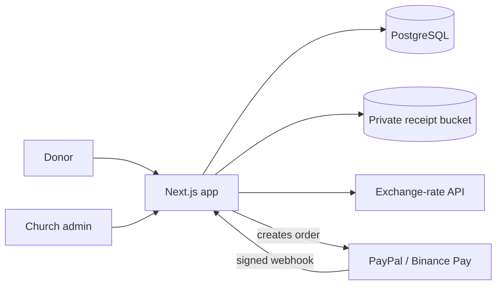

# Maranatha

> The website of a church in Venezuela: visitors find out when and where it meets, and members give tithes and donations online from three payment regions.

*Sitio de la Iglesia Maranatha: agenda, prédicas y proyectos, con diezmos y aportes en línea.*
*Incluye un panel privado donde el equipo de la iglesia aprueba los pagos reportados.*

[Live site](https://maranatha-pi.vercel.app) · In production · v0.9.0 · [](https://github.com/Fockus26/maranatha/actions/workflows/ci.yml)

<!-- Screenshot pending: docs/readme/home.png (home page, 1440×900, demo data). -->

## What it does

- A visitor sees the church's meeting agenda, its service areas and leaders, the latest sermons and the latest posts from its three social accounts.
- A member gives a tithe or an offering, one time or monthly, and pays with what they already have: a card, a local bank transfer in Venezuela or Colombia, or a crypto wallet.
- Before paying by local transfer, the member sees the amount converted to bolívares or Colombian pesos at the day's rate.
- A donor supports a specific church project and sees how much it has raised; only confirmed payments count.
- A church administrator opens the private panel, looks at the receipt a donor uploaded, and approves or rejects the payment. Card payments confirm themselves.
- An administrator edits the agenda from the panel and the public site shows the change.

## How it is built

| Layer | Choice |
|---|---|
| Framework | Next.js 16 (App Router, Server Actions), React 19 with React Compiler, strict TypeScript |
| UI | shadcn/ui on Radix, Tailwind 4 driven by generated design tokens, light and dark mode resolved on the server |
| Data | PostgreSQL with Drizzle ORM; SQL migrations, triggers and a view for the amount raised per project |
| Auth | Better Auth, admin panel only: no sign-up, access by an allow-list, password recovery by email |
| Payments | PayPal (one-time orders and monthly subscriptions, webhook), Binance Pay (webhook), and manual methods reported with a receipt |
| Files | Receipts in a private Cloudflare R2 bucket per environment |
| External data | YouTube (sermons), Behold (Instagram feeds), DolarApi (exchange rates) |
| Hosting | Docker image on a VPS with a preview per pull request; Vercel as fallback |



## Decisions worth noting

**One payment flow for donors that no single gateway covers.**
Donors are in Venezuela, Colombia and abroad, and no gateway serves all three. The site combines PayPal (confirmed by return URL plus webhook) with manual methods: the donor pays by local transfer, reports the reference and uploads a receipt, and an admin approves it. A method only appears when its environment variables are set, and Binance switches from manual to automatic gateway the same way, because merchant verification for the church was not guaranteed. The cost: two code paths for one method, a review queue someone has to work through, and Binance refunds that are still marked by hand.

**Leaving Supabase for a self-hosted Postgres.**
Database, auth and storage moved from Supabase to a Postgres server with Drizzle and Better Auth, to keep a fixed hosting cost with the database next to the app. The schema reproduces the original migrations, including check constraints and a partial unique index on the normalized payment reference; functions, triggers and the view were rewritten by hand. Existing admin passwords kept working because the old bcrypt hashes are still verified and upgraded when a password changes. The cost: every open session was lost at the cut, and password recovery email had to be built since the platform no longer provided it.

**Receipts live in a private bucket and never get a public URL.**
Uploaded receipts (images or PDF, up to 4 MB) go to an R2 bucket per environment. The browser never receives a signed URL: the panel serves each file through a route that checks the admin session first and re-validates the file type from its bytes. Requests are signed with a 2.5 kB library instead of the AWS SDK, which would have been far heavier for four calls. The cost: receipts left the nightly database backup, and reads fall back to the old database table until the earlier files are copied over.

**Keeping the admin panel fresh without polling.**
A webhook can confirm a payment while an admin has the panel open, and server-side revalidation does not reach an open browser tab; showing a confirmed payment as pending is a real risk. On mount, focus and tab visibility the panel compares a cheap version token (row count plus latest update time) with the server, at most once every 15 seconds, and refreshes only if it differs. Polling and websockets were discarded: one queries when nobody is looking, the other needs new infrastructure. The cost: a change made while the admin stares at a focused tab shows up only on the next focus or navigation.

## Quality

- **Tests:** about 130 unit tests in 20 files (payment gateway signatures and reconciliation, receipt storage, agenda rules, session proxy, design-token generation) plus a database integration suite that runs against a local Postgres.
- **Guard tests:** one fails if the generated token stylesheet drifts from its source; another fails if the removed component library reappears in the code or the dependencies.
- **CI:** every pull request runs typecheck, lint (Biome), the unit suite and a production build. The build passes with no environment variables set.
- **Accessibility and performance:** scripts for axe-core (`bun run a11y`) and Lighthouse (`bun run lighthouse`) run against the live app; motion respects the reduced-motion preference.
- **Abuse limits:** login is rate-limited per IP and per account.

## Run it locally

Requires [Bun](https://bun.sh) and a PostgreSQL database.

```bash
bun install
cp .env.example .env.development.local   # then fill in the values you need
bun run db:migrate                       # applies drizzle/ to DIRECT_URL
bun scripts/create-admin.ts you@example.com "Admin"
bun dev
```

Environment variables, by name (see `.env.example` for what each one does):

- Site: `NEXT_PUBLIC_SITE_URL`, `ADMIN_HOST` (optional, serves the panel from a subdomain)
- Database: `DATABASE_URL`, `DIRECT_URL`
- Auth: `BETTER_AUTH_SECRET`, `BETTER_AUTH_URL`, `ADMIN_EMAILS`
- Email: `SMTP_HOST`, `SMTP_PORT`, `SMTP_USER`, `SMTP_PASS`, `SMTP_FROM`
- Receipts: `R2_ACCOUNT_ID`, `R2_ACCESS_KEY_ID`, `R2_SECRET_ACCESS_KEY`, `R2_BUCKET` (without them, receipts are stored in the database)
- Payments: `PAYPAL_*`, `BINANCE_PAY_*`, and one `PAY_*` group per manual method. A method without its variables is simply not offered.
- Instagram feeds: `BEHOLD_FEED_*`

Other commands: `bun run test`, `bun run test:db`, `bun run typecheck`, `bun run lint`, `bun run build`.

## Project structure

```
app/            Routes: public site, payment return pages, admin panel, webhooks
  actions/      Server Actions: payments, admin approval, agenda, auth
  api/          Auth handler, health check, PayPal and Binance webhooks
  dashboard/    Admin panel: summary, payments, agenda, projects, login and recovery
components/     Sections of the public site, layout, and UI primitives (shadcn/ui)
lib/            Domain code: payments, agenda, auth, database schema, email
theme/          Design tokens, colour roles per mode, fonts
drizzle/        SQL migrations, functions, triggers and seed
tests/          Unit and integration tests
scripts/        Token generation, admin creation, QA and accessibility tooling
context/        Project context and the numbered decision records
```

## My role

Built for Iglesia Maranatha. I developed the whole product: the public site, the payment flows and their webhooks, the admin panel, the database and its migration off Supabase, and the deployment pipeline.
